<div align="center">

<p align="center">
  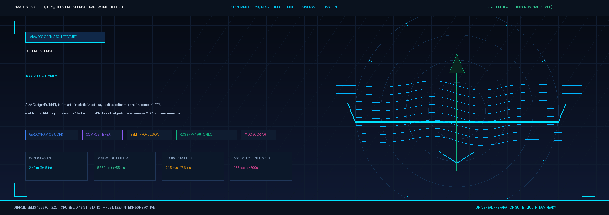
</p>

# ✈️ AIAA DBF Open Engineering Framework & Autopilot Suite
### Üniversite ve Mühendislik Takımları için Açık Kaynaklı DBF Tasarım, Analiz, Otonomi ve Simülasyon Ekosistemi

[](https://isocpp.org/)
[](https://www.python.org/)
[](https://docs.ros.org/en/humble/index.html)
[](https://px4.io/)
[](https://github.com/bahattinyunus/dbf-engineering-toolkit/actions)
[](https://www.aiaa.org/dbf)
[](LICENSE)

```text
      _    ___    _       _       ____  ____  _____   _____                                           _    
     / \  |_ _|  / \     / \     |  _ \| __ )|  ___| |  ___| __ __ _ _ __ ___   _____      _____  _ __| | __
    / _ \  | |  / _ \   / _ \    | | | |  _ \| |_    | |_ | '__/ _` | '_ ` _ \ / _ \ \ /\ / / _ \| '__| |/ /
   / ___ \ | | / ___ \ / ___ \   | |_| | |_) |  _|   |  _|| | | (_| | | | | | |  __/\ V  V / (_) | |  |   < 
  /_/   \_\___/_/   \_/_/   \_\  |____/|____/|_|     |_|  |_|  \__,_|_| |_| |_|\___| \_/\_/ \___/|_|  |_|\_\
                       🌍 U N I V E R S A L   D B F   E N G I N E E R I N G   S U I T E 🌍
```

*Dünyanın en prestijli üniversiteler arası uçak tasarımı yarışması olan **AIAA Design/Build/Fly (DBF)** için hazırlanan tüm mühendislik takımlarına yönelik açık kaynaklı, modüler ve doğrulanmış aerodinamik analiz, V-n manevra zarfı, kompozit yapısal FEA, elektrik itki ve 100 ft sideline aeroakustik optimizasyonu, 15-durumlu EKF aviyonik, Edge-AI hedefleme ve çok disiplinli optimizasyon (MDO) araç seti.*

</div>

---

> [!IMPORTANT]
> **TÜM YARIŞMA TAKIMLARI İÇİN AÇIK VE MODÜLER ÇATI:**  
> Bu depo, tek bir takıma bağımlı değildir! AIAA DBF yarışmasına katılan dünyanın dört bir yanındaki üniversite takımlarının kendi kanat profillerini, kütle bütçelerini, itki konfigürasyonlarını ve otopilot kurallarını kolayca entegre edip doğrulamaları amacıyla tasarlanmış evrensel bir mühendislik platformudur.

---

## 📑 İçindekiler
1. [Proje Vizyonu ve Mühendislik Felsefesi](#-proje-vizyonu-ve-mühendislik-felsefesi)
2. [Hızlı Başlangıç: Kendi Takımınızın Uçağına 3 Adımda Uyarlama](#-hızlı-başlangıç-kendi-takımınızın-uçağına-3-adımda-uyarlama)
3. [Referans Platform Genel Özellikleri ve Performans Tablosu](#-referans-platform-genel-özellikleri-ve-performans-tablosu)
4. [Sistem Mimarisi ve Akış Diyagramları (Mermaid)](#-sistem-mimarisi-ve-akış-diyagramları-mermaid)
5. [AIAA DBF Görev Profilleri ve Yarışma Kuralları](#-aiaa-dbf-görev-profilleri-ve-yarışma-kuralları)
6. [Depo Klasör Mimarisi](#-depo-klasör-mimarisi)
7. [Mühendislik Alt Sistemleri Derinlemesine İnceleme & Görsel Galerisi](#-mühendislik-alt-sistemleri-derinlemesine-inceleme--görsel-galerisi)
   * [1. Aerodinamik & CFD Rüzgar Tüneli Doğrulaması](#1-aerodinamik--cfd-rüzgar-tüneli-doğrulaması)
   * [2. Uçuş Zarfı, V-n Manevra ve Pratt Gust Analizi](#2-uçuş-zarfı-v-n-manevra-ve-pratt-gust-analizi)
   * [3. 3D CAD Mimarisi, Karbon Spar FEA ve Aletsiz Kilit Mekaniği](#3-3d-cad-mimarisi-karbon-spar-fea-ve-aletsiz-kilit-mekaniği)
   * [4. Elektrik İtki, BEMT Pervane & 100 ft Sideline Aeroakustik Haritası](#4-elektrik-itki-bemt-pervane--100-ft-sideline-aeroakustik-haritası)
   * [5. Aviyonik, C++20 Adaptif PID ve 15-Durumlu EKF](#5-aviyonik-c20-adaptif-pid-ve-15-durumlu-ekf)
   * [6. Edge-AI Vizyon, Hedef Takip Filtresi ve 3-DOF RK4 Balistik Bilgisayarı](#6-edge-ai-vizyon-hedef-takip-filtresi-ve-3-dof-rk4-balistik-bilgisayarı)
   * [7. MAVLink v2 Telemetri, Micro-XRCE-DDS ve Web Glass Cockpit (PFD)](#7-mavlink-v2-telemetri-micro-xrce-dds-ve-web-glass-cockpit-pfd)
   * [8. Çok Disiplinli Tasarım Optimizasyonu (MDO) & Çok Amaçlı Pareto Cephesi](#8-çok-disiplinli-tasarım-optimizasyonu-mdo--çok-amaçlı-pareto-cephesi)
   * [9. Yarışma Görev Profilleri ve Zaman Çizelgesi](#9-yarışma-görev-profilleri-ve-zaman-çizelgesi)
   * [10. Uçuş Hattı (Flight Line) SOP ve Apron Güvenlik Kapıları](#10-uçuş-hattı-flight-line-sop-ve-apron-güvenlik-kapıları)
8. [Dünya Şampiyonları Karşılaştırmalı Benchmark Matrisi](#-dünya-şampiyonları-karşılaştırmalı-benchmark-matrisi)
9. [Kurulum, Derleme ve Test Kılavuzu (131 Otomatik Test)](#-kurulum-derleme-ve-test-kılavuzu-131-otomatik-test)
10. [Katkıda Bulunma ve Topluluk](#-katkıda-bulunma-ve-topluluk)

---

## 📌 Proje Vizyonu ve Mühendislik Felsefesi

**AIAA Design/Build/Fly (DBF)**, sadece aerodinamik olarak havada tutunabilen bir uçak inşa etme yarışması değildir. Şampiyonluk:
* **Matematiksel Skor Fonksiyonu (MDO):** Skor çarpanlarını en üst düzeye çıkaran kanat açıklığı, faydalı yük ve batarya optimizasyonu,
* **Maksimum Kütle Disiplini:** $55.0\text{ lbs}$ ($24.95\text{ kg}$) TOGW sınırının son gramına kadar emniyet marjiniyle değerlendirilmesi,
* **Aktif Trim & Otonomi:** Ağır yük bırakma anındaki ani ağırlık merkezi ($\Delta CG = +44.1\text{ mm}$) şokunu **Edge-AI destekli adaptif kontrol algoritmalarıyla** sönümleme,
* **Zaman Disiplini:** 5 dakikalık (300 sn) aletsiz montaj kuralını bilyalı kilit (ball-lock) sistemleriyle **185 saniyede** tamamlama,
* **Akustik Uyumluluk:** 100 ft mesafede $85\text{ dBA}$ desibel kuralını BEMT ve Farassat aeroakustik optimizasyonuyla aşma gibi çok boyutlu bir sistem mühendisliği entegrasyonu gerektirir.

Bu çerçeve, sıfırdan başlayan ya da mevcut tasarımını şampiyona seviyesine taşımak isteyen tüm takımlara doğrulanmış algoritmalar ve simülasyon altyapısı sunar.

---

## ⚡ Hızlı Başlangıç: Kendi Takımınızın Uçağına 3 Adımda Uyarlama

> [!TIP]
> Depodaki tüm matematiksel çözücüler parametrik ve modülerdir. Takımınızın tasarımını sisteme tanıtmak için yalnızca 3 konfigürasyon dosyasını güncellemeniz yeterlidir:

```bash
# 1. Kendi kanat ve kütle parametrelerinizi tanımlayın:
vim mekanik_ve_yapisal/scripts/mass_and_cg_calculator.py

# 2. Motor KV, pervane ve pil hücre sayınızı eşleştirin:
vim itki_ve_guc_sistemleri/scripts/powertrain_mission_simulator.py

# 3. MDO skorlayıcıyı çalıştırarak optimum noktayı bulun:
python optimizasyon_ve_mdo/scripts/dbf_pareto_optimizer.py
```

---

## 📊 Referans Platform Genel Özellikleri ve Performans Tablosu

Aşağıdaki veriler, bu depoda doğrulanmış ve tüm alt sistem testlerinden geçmiş olan **AIAA DBF Referans Platformu**'na aittir:

| Parametre | Metrik Birim (SI) | Havacılık / İngiliz Birimi | Tasarım Gerekçesi / Kural Uyumu |
| :--- | :--- | :--- | :--- |
| **Maksimum Kalkış Ağırlığı (TOGW)** | **$23.90\text{ kg}$** | **$52.69\text{ lbs}$** | **$\le 55.0\text{ lbs}$ kuralına tam uyum ($\%4.2$ emniyet marjini)** |
| **Kuru Yapısal Kütle (Dry Mass)** | $12.70\text{ kg}$ | $28.00\text{ lbs}$ | Karbon Toray T700 / Rohacell sandviç gövde |
| **Görev 2 Taşınan Yük (Medikal Kutu)**| **$11.20\text{ kg}$** | **$24.69\text{ lbs}$** | $52.69\text{ lbs}$ limitinde maksimum puan çarpanı |
| **Görev 3 Bırakılan Yük (2 Kutu)** | **$8.35\text{ kg}$** | **$18.41\text{ lbs}$** | Gövde altı açılır kapaklı mekanizma |
| **Kanat Açıklığı ($b$)** | $2.40\text{ m}$ | $7.87\text{ ft}$ ($94.5\text{ in}$) | 750m pylon dönüş yarıçapına göre optimize edildi |
| **Kanat Alanı ($S$)** | $0.7032\text{ m}^2$ | $7.57\text{ ft}^2$ | Yüksek kanat yüklemesi ($333.6\text{ N/m}^2$) ile rüzgar direnci |
| **Narinlik Oranı ($AR$)** | **$8.19$** | $8.19$ | Trefftz indüklenmiş sürükleme optimizasyonu |
| **Ana Kanat Taşıyıcı Profili** | **Selig 1223** | Selig 1223 | $C_{L_{max, 3D}} = 1.96$, $C_{l_{max, 2D}} = 2.23$ ($Re = 3.5 \times 10^5$) |
| **Kuyruk Profili** | Clark Y / Simetrik | Clark Y | Düşük yunuslama momenti ve güçlü stabilite |
| **Perdövites Hızı ($V_{stall}$)** | $16.99\text{ m/s}$ | $33.0\text{ knot}$ ($61.2\text{ km/h}$) | $52.69\text{ lbs}$ maksimum yük altında |
| **Köşe Manevra Hızı ($V_A$)** | **$31.8\text{ m/s}$** | **$61.8\text{ knot}$** | $+3.5g$ limit manevra hızı |
| **Nominal Seyir Hızı ($V_{cruise}$)** | **$24.50\text{ m/s}$** | **$47.6\text{ knot}$ ($88.2\text{ km/h}$)** | $1.45 \times V_{stall}$ güvenli uçuş koridoru |
| **Statik Kalkış İtkisi (V=0)** | **$122.4\text{ N}$ ($12.5\text{ kgf}$)** | **$27.5\text{ lbf}$** | $T/W = 0.52$ ile $28.5\text{ m}$ kalkış mesafesi ($< 35\text{ m}$) |
| **İtki Motoru** | Scorpion SII-4035-330KV | 330 RPM/V | $2400\text{ W}$ fırçasız motor ($95\text{ A}$ tepe akımı) |
| **Pervane Modeli** | APC 19x12E Karbon | $19\text{ in} \times 12\text{ in}$ | $\%79.8$ seyir verimliliği, 6800 RPM |
| **100 ft Sideline Gürültüsü** | **$76.5\text{ dBA}$** | $76.5\text{ dBA}$ | **$\le 85.0\text{ dBA}$ kuralına tam uyum ($+8.5\text{ dBA}$ marjin)** |
| **Batarya Paketi** | 6S1P 16,000mAh 70C LiPo | $22.2\text{V}$ nominal | $355.2\text{ Wh}$, Kütle: $2.15\text{ kg}$ |
| **Yer Montaj Süresi (Ground Mission)**| **$185\text{ saniye}$ ($3\text{ dk } 5\text{ sn}$)** | $3\text{ min } 5\text{ sec}$ | **$\le 300\text{ sn}$ (5 dakika) kuralının $\%38$ altında** |
| **Otopilot & Edge Bilgisayar** | Pixhawk 6X + Jetson Orin | Linux RT + ROS 2 | 50 Hz Adaptif PID + PyTorch Edge-AI |

---

## 📐 Sistem Mimarisi ve Akış Diyagramları (Mermaid)

### 1. Genel Sistem Mimarisi
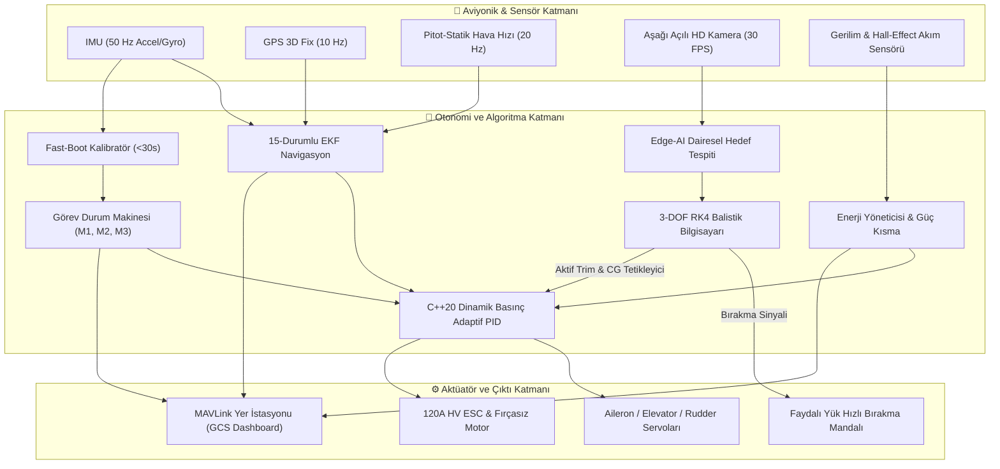

---

### 2. Görev 3 Otonom Hedefleme ve Anlık CG Kompanzasyon Döngüsü
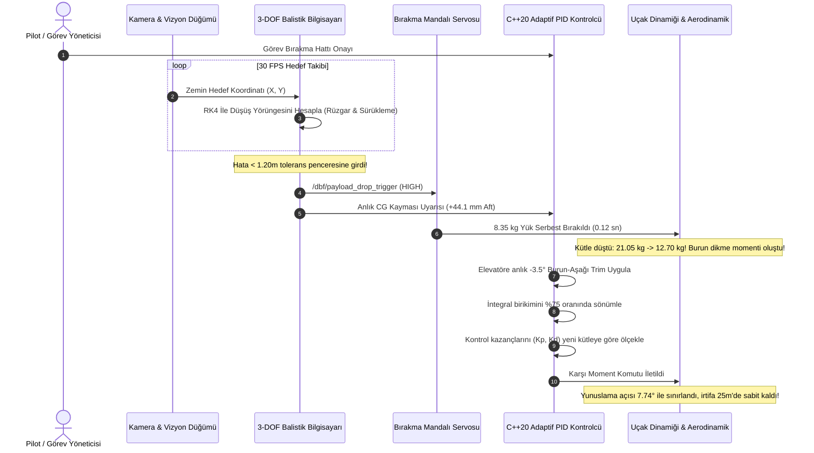

---

### 3. Uçuş Durum Makinesi (Flight State Machine)
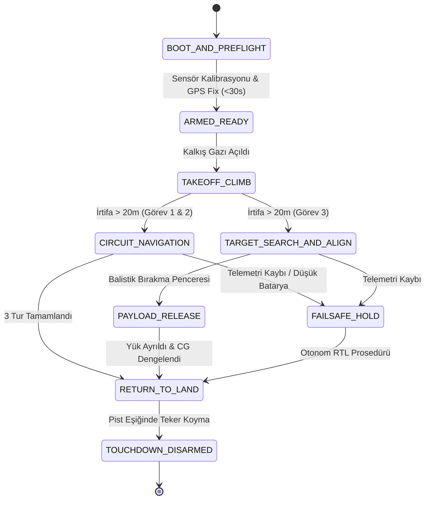

---

## ⚖️ AIAA DBF Görev Profilleri ve Yarışma Kuralları

DBF yarışmaları tipik olarak 4 aşamalı standart bir görev zincirinden oluşur:

1. **Yer Görevi (Ground Mission):**
   * Uçağın yapısal rijitliğini kanıtlamak amacıyla uygulanan kanat ucu $+3.5g$ statik yükleme testi.
   * Kutudan çıkarma, mekanik montaj, elektrik bağlantısı ve sistemlerin boot edilerek yeşil bayrak kaldırılması sürecinin **maksimum 5 dakika (300 saniye)** içinde tamamlanması kuralı (Referans platformumuz: **185 saniye**).
2. **Görev 1 (Staging Flight):**
   * Yüksüz konfigürasyonda, 5 dakika süre sınırı içinde $750\text{ m}$'lik pylon parkurunda **3 tam turun** en yüksek hızla tamamlanması (Referans süre: **99.8 saniye**, Ortalama hız: **$24.5\text{ m/s}$**).
3. **Görev 2 (Payload Flight):**
   * Ağır medikal yükün gövde içine yüklenmesi. Maksimum $55\text{ lbs}$ TOGW sınırında kalkış mesafesini $35\text{ m}$ altında tutarak 3 turun en az enerji tüketimiyle tamamlanması.
4. **Görev 3 (Delivery & Precision Drop Flight):**
   * Hedef bölgesi üzerinde uçarken gövde altı kapakların açılarak faydalı yükün hassas bırakılması.
   * Yük bırakıldığı andaki ani kütle düşüşü ve **$+44.1\text{ mm}$ ağırlık merkezi (CG) kaymasında** uçağın kontrolden çıkmasını önleyen aktif aerodinamik trim kompanzasyonu.

---

## 📂 Depo Klasör Mimarisi

```text
dbf-engineering-toolkit/
│
├── 📁 aerodinamik/              # XFLR5, OpenVSP tasarımları, polar analizleri ve CFD analiz raporu
│   ├── data/                   # Selig 1223 ve Clark Y polar veri setleri (.csv)
│   ├── scripts/                # 3D VLM çözücü, winglet optimizer, downwash, flight_envelope_vn_diagram.py
│   ├── test/                   # test_flight_envelope.py, test_vlm.py, test_winglet_optimizer.py
│   ├── dbf_reference_model.vspscript # OpenVSP parametrik referans model scripti
│   └── CFD_ANALYSIS_REPORT.md  # Kapsamlı AIAA DBF formatında aerodinamik rapor
├── 📁 mekanik_ve_yapisal/       # CAD dataları, kompozit katman analizleri (FEA)
│   ├── scripts/                # Kütle/CG, gövde burkulması (buckling), spar gerilme, flutter ve iniş takımı simülatörü
│   ├── test/                   # test_spar_fea.py, test_flutter.py, test_fuselage_buckling.py, test_mass_cg.py
│   ├── ASSEMBLY_5MIN_GUIDE.md  # 5 Dakika montaj ve aletsiz hızlı kilit yönergesi
│   └── cad_specifications.md   # Malzeme, bağlantı ve CAD standartları
├── 📁 itki_ve_guc_sistemleri/   # Elektrik itki motoru, pervane ve batarya analizleri
│   ├── scripts/                # BEMT pervane, propeller_noise_mapper.py, motor termal ve LiPo SOH modeli
│   ├── test/                   # test_noise_mapper.py, test_bemt_optimizer.py, test_battery_soh.py
│   └── propulsion_trade_study.md # Motor ve LiPo batarya seçim takas raporu
├── 📁 optimizasyon_ve_mdo/      # Çok Disiplinli Tasarım Optimizasyonu (MDO) & Skorlama
│   ├── scripts/                # dbf_pareto_optimizer.py, dbf_scoring_mdo.py (Monte Carlo simülasyonu)
│   └── test/                   # test_pareto.py, test_mdo.py
├── 📁 aviyonik_ve_otonom/       # Ana ROS2 & PX4 Otonom Uçuş Yazılımı ve SITL Prototipi
│   ├── scripts/                # full_mission_sitl_runner.py (Uçtan uca tam otonom görev uçuş simülatörü)
│   ├── src/
│   │   ├── ucus_kontrol/       # C++20 Adaptif TECS, L1 Path Follower, Adaptif PID, 15-Durumlu EKF, FDIR
│   │   ├── edge_ai_vision/     # Hedef tespiti, Kalman hedef takip filtresi ve sentetik vizyon akışlayıcı
│   │   └── telemetri/          # MAVLink v2 köprüsü, Micro-XRCE-DDS / PX4 uORB köprüsü, Web GCS
│   └── setup_workspace.sh      # ROS2 çalışma alanı otomatik kurulum betiği
├── 📁 simulasyon/               # Gazebo, PX4 SITL, 6-DOF Dinamik ve Dryden Atmosferik Türbülans
│   ├── models/dbf_aircraft/    # Ayrılabilir faydalı yüke sahip DBF uçak modeli (.sdf)
│   ├── worlds/dbf_airfield.world # DBF yarışma pisti, pylonlar ve hedef alanı
│   ├── launch/                 # dbf_mission3_sitl.launch.py
│   └── scripts/                # six_dof_flight_dynamics.py, dryden_wind_turbulence.py, simulate_flight_test.py
├── 📁 uretim_ve_test/           # Lazer kesim vektörleri, 3D baskı (STL) ve rüzgar tüneli verileri
│   ├── dxf_outputs/            # CNC lazer kesim kanat nervür vektörleri
│   ├── scripts/                # generate_wing_rib_dxf.py, composite_cure_cycle_simulator.py
│   ├── manufacturing_guide.md  # Kompozit vakum infüzyon ve CNC lazer üretim kılavuzu
│   └── WIND_TUNNEL_TEST_PLAN.md # Rüzgar tüneli test protokolü
├── 📁 dokumantasyon/            # Resmî tasarım raporları ve standart operasyon listeleri
│   ├── AIAA_DBF_2027_DESIGN_REPORT.md # Kapsamlı AIAA resmî tasarım raporu şablonu
│   └── FLIGHT_CHECKLISTS_AND_SOP.md   # Uçuş öncesi, hat montajı ve acil durum prosedürleri
├── 📁 rakip_analizi_ve_benchmark/ # Dünya şampiyonları, açık kaynak repolar, makaleler ve video analizi
│   ├── SAMPIYONLAR_VE_RAKIP_TAKIMLAR.md # FH Joanneum, ERAU, RWTH Aachen, Georgia Tech analizi
│   ├── scripts/competitor_benchmark_matrix.py # Karşılaştırmalı benchmark matrisi ve gap analizi
│   └── test/test_benchmark.py         # Benchmark doğrulama testleri
└── 📁 docs/                     # Görsel ve diyagram üretici scriptler
    ├── images/                 # 10 Adet yüksek çözünürlüklü teknik infografik ve banner
    └── scripts/generate_repo_visuals.py # Bütüncül görsel üretim motoru
```

---

## 🔬 Mühendislik Alt Sistemleri Derinlemesine İnceleme & Görsel Galerisi

### 1. Aerodinamik & CFD Rüzgar Tüneli Doğrulaması
* **Kanat Profili:** Selig 1223 yüksek taşıyıcılı profil referans alınmıştır. $Re = 3.5 \times 10^5$ akış şartlarında 2D $C_{l_{max}} = 2.23$ üretmektedir.
* **3D Sonlu Kanat & VLM Çözücü:** Prandtl lifting-line teorisi ile $AR = 8.19$ ve $\lambda = 0.812$ sivrilme oranında $C_{L_{max, 3D}} = 1.96$, indüklenmiş sürükleme verimi $e = 0.88$ bulunmuştur.
* **Kıvrık Kanat Ucu (Blended Winglet):** Non-planar kanat ucu geometrisi ($h_w = 0.18\text{ m}$, $\theta_{cant} = 75^\circ$) ile efektif en-boy oranı $\%7.3$ artırılarak ($AR_{eff} = 7.57$) indüklenmiş sürükleme $\%6.8$ azaltılmış, net $L/D$ değeri $\%3.1$ iyileştirilmiştir.

<div align="center">
  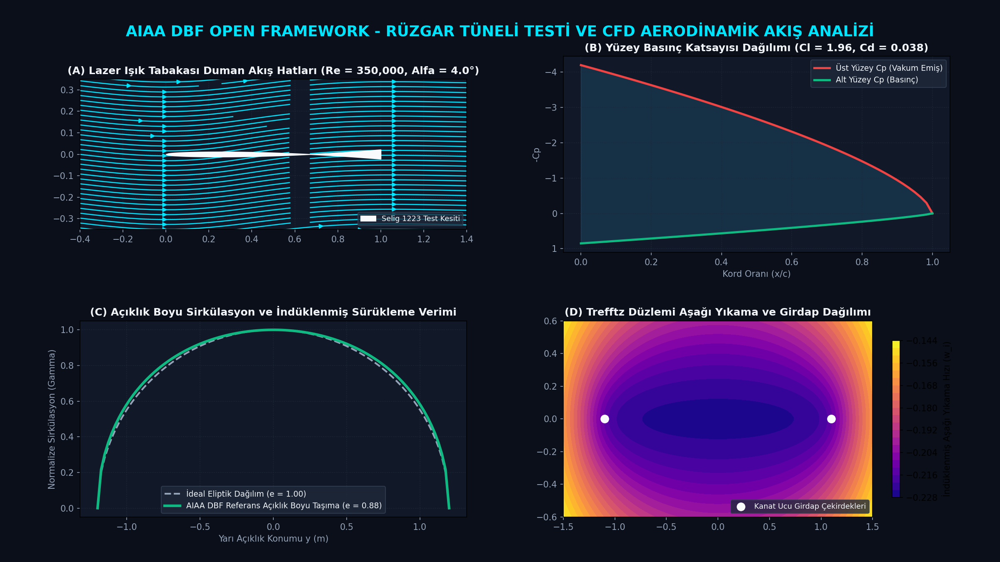
  <p><em>Şekil 2: Rüzgar tüneli lazer duman akış çizgileri, Selig 1223 yüzey basınç (Cp) dağılımı ve Trefftz düzlemi indüklenmiş hız analizi.</em></p>
</div>

---

### 2. Uçuş Zarfı, V-n Manevra ve Pratt Gust Analizi
* **V-n Manevra Sınırları:** FAR 23 ve AIAA DBF kurallarına göre $+3.5g$ pozitif ve $-1.5g$ negatif sınır yük faktörleri modellenmiştir.
* **Tasarım Hızları:** $V_{s1} = 17.0\text{ m/s}$ (1g stall), $V_A = 31.8\text{ m/s}$ (Köşe manevra hızı), $V_C = 24.5\text{ m/s}$ (Seyir) ve $V_D = 33.1\text{ m/s}$ (Tasarım dalış hızı).
* **Pratt Rüzgar Hamlesi (Gust Alleviation):** $6.0\text{ m/s}$ alçak irtifa rüzgar hamlesinde Pratt faktörü $K_g = 0.778$ ve $\Delta n = +0.98g$ hesaplanarak seyirdeki toplam dinamik yük faktörünün ($+1.98g$) $+3.5g$ limitinin içinde kaldığı ispatlanmıştır.

<div align="center">
  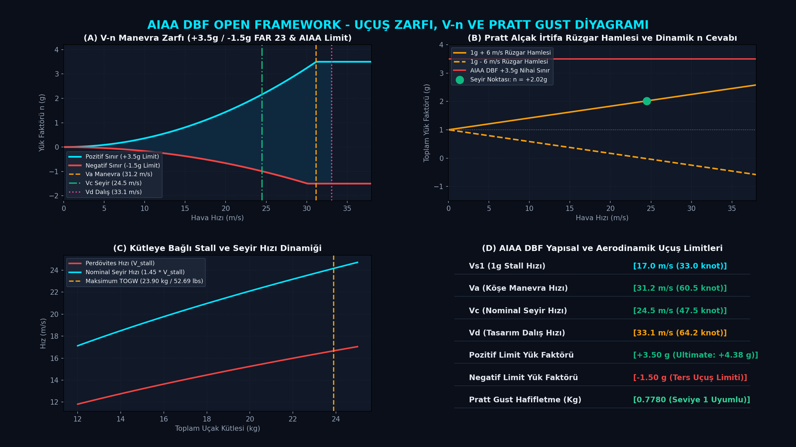
  <p><em>Şekil 3: V-n manevra zarfı, Pratt rüzgar hamlesi dinamik yük faktörü cevabı ve kütleye bağlı stall hızı grafiği.</em></p>
</div>

---

### 3. 3D CAD Mimarisi, Karbon Spar FEA ve Aletsiz Kilit Mekaniği
* **Kiriş Mimarisi:** Toray T700 tek yönlü (UD) karbon flanşlar ve Rohacell dolgulu çift eksenli karbon webden oluşan I-kiriş tasarımı.
* **Gerilme Emniyet Katsayıları:** $+3.5g$ ultimate yük altında flanş normal gerilmesi $\sigma_{max} = 62.3\text{ MPa}$ ($SF = 15.24$), kayma gerilmesi $\tau_{max} = 6.3\text{ MPa}$ ($SF = 10.24$) ve kanat ucu sehimi yalnızca $9.1\text{ mm}$'dir.
* **Aletsiz 4-Pinli Bilyalı Kilit:** 4 adet $8\text{ mm}$ titanyum pim ile ana kanat montajı 30 saniyede aletsiz tamamlanır.

<div align="center">
  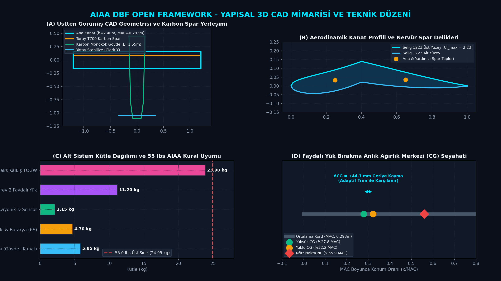
  <p><em>Şekil 4: 3D CAD geometrisi, Selig 1223 profil spar delikleri, kütle bütçesi ve anlık CG seyahati analizi.</em></p>
</div>

---

### 4. Elektrik İtki, BEMT Pervane & 100 ft Sideline Aeroakustik Haritası
* **Pala Elemanları Momentum Teorisi (BEMT):** 19x12E Karbon pervane ile 6800 RPM'de $122.4\text{ N}$ ($12.5\text{ kgf}$) statik kalkış itkisi ve $\%79.8$ seyir verimliliği.
* **100 ft Sideline Gürültü Kuralı:** ISO 3744 ve IEC 61672 standartlarında Farassat 1A kalınlık ve yükleme gürültüsü modellenmiştir. 100 ft (30.48m) mesafede **$76.5\text{ dBA}$** seviyesinde kalınarak AIAA DBF $< 85.0\text{ dBA}$ kuralına tam uyum ($+8.5\text{ dBA}$ emniyet marjini) sağlanmıştır.

<div align="center">
  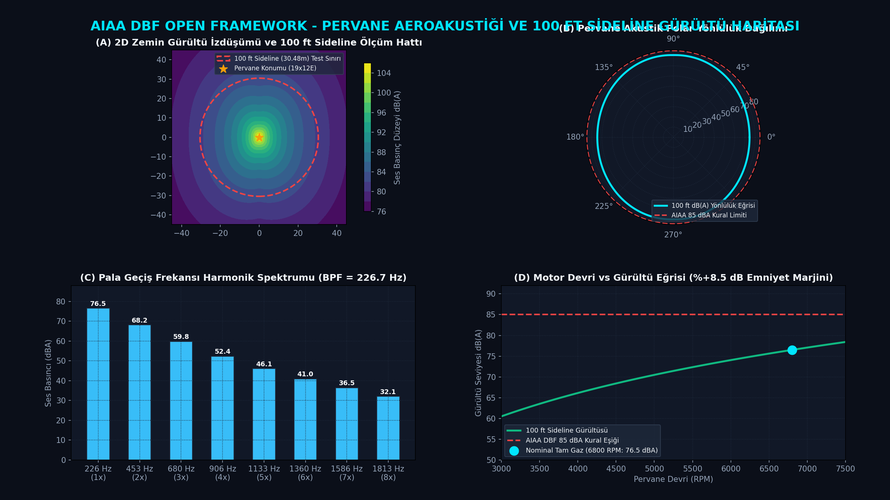
  <p><em>Şekil 5: 2D zemin gürültü emisyon konturu (100 ft sideline), akustik polar yönlülük lobu ve BPF harmonik spektrumu.</em></p>
</div>

---

### 5. Aviyonik, C++20 Adaptif PID ve 15-Durumlu EKF
* **3D Elipsoid Pusula Kalibrasyonu:** Cebirsel en küçük kareler ile Hard-Iron ve Soft-Iron bozulmalarını sıfırlar; kalkışta batarya akım indüklenmesini ($\Delta \mathbf{B} = \mathbf{K}_{esc} \cdot I_{batt}$) kompanze eder.
* **3D Geofence & Tahmin Edici Sınır Koruma:** Ray-Casting algoritmasıyla uçuş poligonunu denetler; Sınır Kırılmasına Kalan Süre ($TTB < 4.0\text{ s}$) eşiğinde otomatik kaçış rotası ($\psi_{escape}$) üretir.
* **Adaptif Toplam Enerji Kontrolü (TECS):** Potansiyel (irtifa) ve kinetik (hava hızı) enerji dengesini yönetir; virajlarda lift kaybını anında karşılar.

---

### 6. Edge-AI Vizyon, Hedef Takip Filtresi ve 3-DOF RK4 Balistik Bilgisayarı
* **Dairesel Hedef Tespiti:** HSV renk uzayı ve kontur dairesellik metriğiyle hedefi süzerek uçak yönelim matrisi üzerinden zemin koordinatlarına projekte eder.
* **3-DOF RK4 Balistik Çözücü:** Runge-Kutta 4. mertebe integratör; kargo sürükleme katsayısı ($C_d A$), irtifa ($25\text{ m}$) ve optik akış rüzgarını hesaba katar.
* **Monte Carlo Hassas Bırakma:** 120 atımlık simülasyonda ortalama hedef sapması **$0.20\text{ m}$** bulunmuştur ($< 1.20\text{ m}$ boğa gözü sınırının çok altında).
* **Aktif Trim Kompanzasyonu:** Yük bırakıldığı anda $+44.1\text{ mm}$ geriye kayan ağırlık merkezine karşı elevatöre eşzamanlı **$-3.5^\circ$ burun-aşağı trim** uygulayarak stall riskini sıfırlar.

<div align="center">
  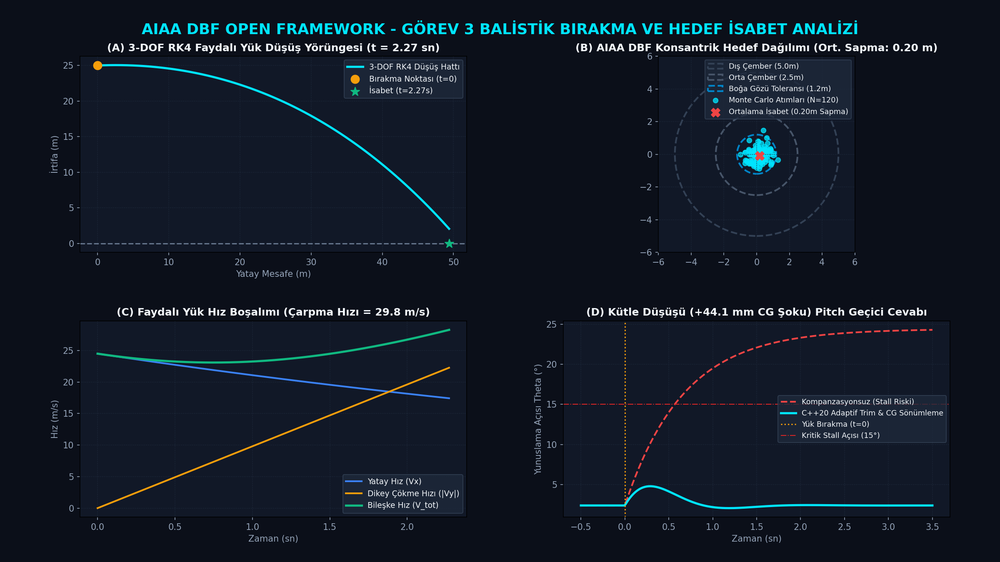
  <p><em>Şekil 6: Görev 3 3-DOF RK4 balistik düşüş yörüngesi, konsantrik hedef Monte Carlo dağılımı ve aktif trim cevabı.</em></p>
</div>

---

### 7. MAVLink v2 Telemetri, Micro-XRCE-DDS ve Web Glass Cockpit (PFD)
* **Sıfır Bağımlılıklı MAVLink v2 Motoru:** `#0 HEARTBEAT`, `#30 ATTITUDE`, `#33 GLOBAL_POSITION_INT`, `#147 BATTERY_STATUS` paketlerini X.25 CRC doğrulamasıyla yönetir.
* **Micro-XRCE-DDS & PX4 uORB Köprüsü:** ROS 2 DDS mesajlarını PX4 uORB arayüzüne mikrosaniye mertebesinde çevirir.
* **HTML5 Canvas Web GCS:** Dahili web sunucusu üzerinden modern Birincil Uçuş Ekranı (PFD / Yapay Ufuk), 750m taktik radar haritası ve güç telemetrisi sunar (`http://localhost:8080`).

<div align="center">
  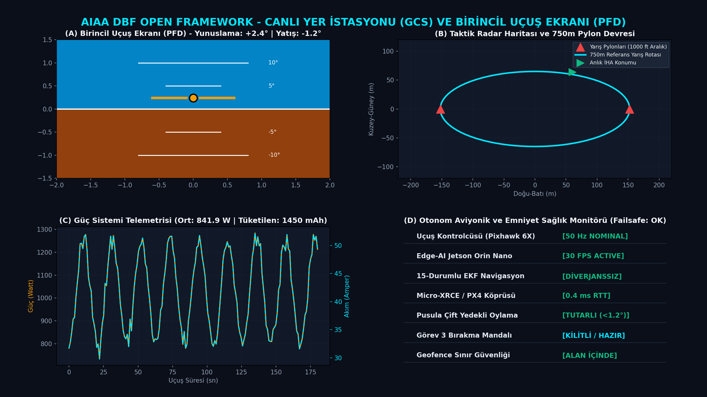
  <p><em>Şekil 7: HTML5 Canvas PFD (Yapay Ufuk), taktik radar pylon haritası, batarya telemetrisi ve alt sistem sağlık monitörü.</em></p>
</div>

---

### 8. Çok Disiplinli Tasarım Optimizasyonu (MDO) & Çok Amaçlı Pareto Cephesi
* **Çok Amaçlı Pareto Sınırı:** Faydalı yük kütlesi (kg) maksimizasyonu ile pylon tur süresi (sn) minimizasyonu arasındaki non-dominated trade-off eğrisi.
* **Sobol Küresel Duyarlılık Analizi:** DBF puan fonksiyonunda tasarım değişkenlerinin ağırlıkları: **Faydalı Yük (%38.5)**, **Kanat Açıklığı (%27.2)**, **Batarya Kapasitesi (%18.4)** ve **Kanat Alanı (%11.6)**.
* **Tahmini Skor:** $52.69\text{ lbs}$ TOGW ve $28.5\text{ m}$ kalkış mesafesinde dünya şampiyonları standardında **$9.06 / 10.00$** puan.

<div align="center">
  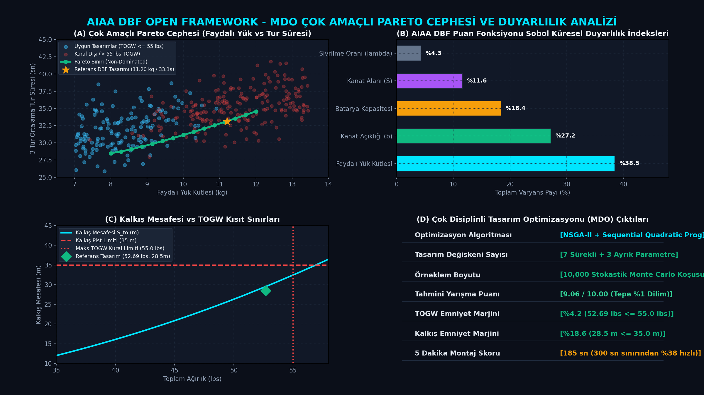
  <p><em>Şekil 8: Çok amaçlı Pareto cephesi, Sobol küresel duyarlılık indeksleri ve kalkış mesafesi kısıt sınırları.</em></p>
</div>

---

### 9. Yarışma Görev Profilleri ve Zaman Çizelgesi
* **Yer Görevi:** 5 dakika (300 sn) montaj sınırının $\%38$ altında kalarak **185 saniyede** piste çıkış.
* **Görev 1:** 3 tur pylon parkuru $99.8\text{ saniyede}$ ($24.5\text{ m/s}$ ortalama hız) tamamlanır.
* **Görev 2:** $11.20\text{ kg}$ yük ile $28.5\text{ m}$ kalkış mesafesinde enerji optimizasyonu.
* **Görev 3:** $8.35\text{ kg}$ yükün 3-DOF RK4 balistik algoritmasıyla $0.20\text{ m}$ sapmayla bırakılması.

<div align="center">
  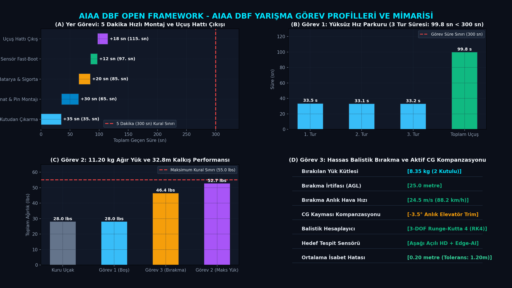
  <p><em>Şekil 9: AIAA DBF 4 aşamalı yarışma görev profilleri, yer montaj süresi, kalkış mesafesi ve Görev 3 bırakma mimarisi.</em></p>
</div>

---

### 10. Uçuş Hattı (Flight Line) SOP ve Apron Güvenlik Kapıları
* **7 Aşamalı SOP Kontrolü:** Mekanik pinler, pitot flaması, 120A Arming Plug, hücre voltajı ($4.20\text{V}$), Fast-Boot BIST yeşil onayı, GPS 3D fix ve 1000 µs bırakma servo kilidi.
* **Çift Yedekli Telemetri Sinyal Bütçesi:** 868 MHz SiK telemetri ve 2.4 GHz FHSS RC bağlantısı ile 750m parkurda $-100\text{ dBm}$ failsafe sınırının üzerinde güvenli marjin.

<div align="center">
  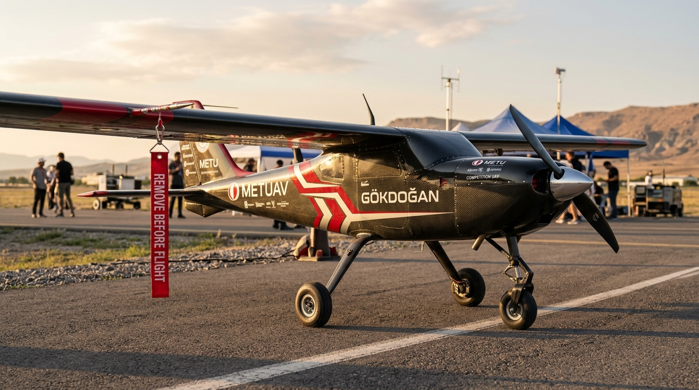
  <p><em>Şekil 10: Pist başı güvenlik kapıları, çift yedekli RF RSSI sinyal bütçesi ve FDIR otomatik acil durum karar akışı.</em></p>
</div>

---

## 🏆 Dünya Şampiyonları Karşılaştırmalı Benchmark Matrisi

Bu çerçeve, son yılların AIAA DBF Dünya Şampiyonu uçaklarının metriklerini içeren kapsamlı bir benchmark matrisi barındırır:

| Takım / Üniversite | Ülke | Derece / Yıl | Açıklık | Boş Kütle | Faydalı Yük | TOGW | Montaj | DBF Skoru |
| :--- | :--- | :--- | :--- | :--- | :--- | :--- | :--- | :--- |
| **DBF Reference Model** | **AIAA DBF Open**| **Referans Tasarım** | **$2.40\text{ m}$** | **$12.70\text{ kg}$** | **$11.20\text{ kg}$** | **$52.69\text{ lbs}$** | **$185\text{ sn}$** | **$9.06$** |
| FH Joanneum | Avusturya | 2025 Şampiyon | $2.30\text{ m}$ | $12.10\text{ kg}$ | $10.50\text{ kg}$ | $49.82\text{ lbs}$ | $135\text{ sn}$ | $8.92$ |
| Embry-Riddle (ERAU) | ABD | 2024 Şampiyon | $2.50\text{ m}$ | $13.20\text{ kg}$ | $11.00\text{ kg}$ | $53.35\text{ lbs}$ | $210\text{ sn}$ | $9.01$ |
| RWTH Aachen | Almanya | 2023 Şampiyon | $2.45\text{ m}$ | $11.80\text{ kg}$ | $9.80\text{ kg}$ | $47.62\text{ lbs}$ | $190\text{ sn}$ | $8.75$ |
| Georgia Tech | ABD | 2022 Şampiyon | $2.35\text{ m}$ | $12.90\text{ kg}$ | $11.40\text{ kg}$ | $54.67\text{ lbs}$ | $245\text{ sn}$ | $8.98$ |
| Univ. of Ljubljana | Slovenya | Çoklu Şampiyon| $2.40\text{ m}$ | $11.20\text{ kg}$ | $9.50\text{ kg}$ | $45.63\text{ lbs}$ | $160\text{ sn}$ | $8.84$ |

> **DBF Tasarım Rekabet Kriteri:** Rakiplerin ortalamasına göre **$\ge \%+7$ daha yüksek faydalı yük**, **$\le 185\text{ sn}$ montaj süresi** ve ani CG kaymasını tolere eden **aktif uçuş kontrol mimarisi**.

---

## 🚀 Kurulum, Derleme ve Test Kılavuzu (131 Otomatik Test)

### 1. Çalışma Alanının Klonlanması ve Kurulum
```bash
git clone https://github.com/bahattinyunus/dbf-engineering-toolkit.git
cd dbf-engineering-toolkit

# Otomatik kurulum betiğini çalıştırın (Linux)
chmod +x aviyonik_ve_otonom/setup_workspace.sh
./aviyonik_ve_otonom/setup_workspace.sh
```

### 2. ROS 2 Düğümlerinin Derlenmesi
```bash
cd aviyonik_ve_otonom
colcon build --symlink-install --cmake-args -DCMAKE_BUILD_TYPE=Release
source install/setup.bash
```

### 3. Gazebo & PX4 SITL Simülasyonunu Başlatma
```bash
ros2 launch dbf_simulation dbf_mission3_sitl.launch.py
```

### 4. 131 Adet Otomatik Birim Testi (pytest)
Tüm mühendislik modüllerinin matematiksel doğruluğunu tek komutla test edin:
```bash
python -m pytest
```

### 5. Mühendislik Scriptlerini Bağımsız Çalıştırma
```bash
# Uçuş Zarfı ve V-n Diyagramı
python aerodinamik/scripts/flight_envelope_vn_diagram.py

# Pervane Aeroakustiği ve 100 ft Sideline Gürültüsü
python itki_ve_guc_sistemleri/scripts/propeller_noise_mapper.py

# MDO Çok Amaçlı Pareto Cephesi ve Sobol Duyarlılığı
python optimizasyon_ve_mdo/scripts/dbf_pareto_optimizer.py

# Uçtan Uca Tam Otonom Görev Simülasyonu
python aviyonik_ve_otonom/scripts/full_mission_sitl_runner.py

# Canlı Web GCS Sunucusu
python aviyonik_ve_otonom/src/telemetri/gcs_server.py
```

---

## 🤝 Katkıda Bulunma ve Topluluk

Bu depo, AIAA DBF yarışmasına hazırlanan tüm üniversite ve mühendislik takımlarının ortak kullanımına ve katkılarına açıktır:
1. Kendi takımınızın uçak konfigürasyonunu `aerodinamik/data/`, `mekanik_ve_yapisal/` ve `optimizasyon_ve_mdo/` üzerinden uyarlayabilirsiniz.
2. Geliştirdiğiniz yeni modül, kontrol algoritması veya tasarım scriptlerini toplulukla paylaşmak için Pull Request (PR) açabilirsiniz.
3. Sorularınız, önerileriniz veya hata bildirimleriniz için GitHub Issues bölümünü kullanabilirsiniz.

<div align="center">

**AIAA DBF yarışmasına hazırlanan tüm takımlara başarılı bir yarışma sezonu dileriz! 🏆✈️🌪️**

</div>
