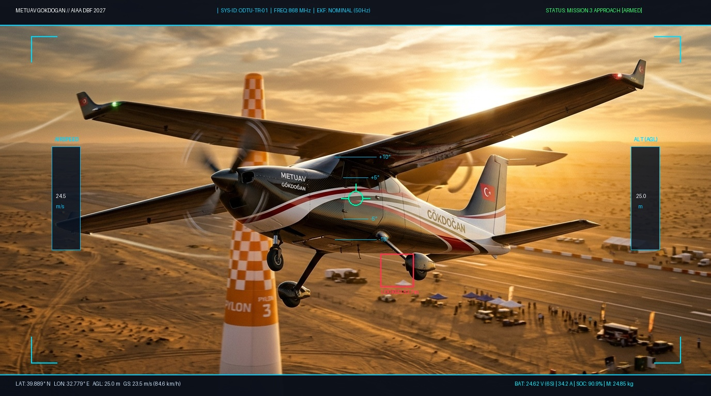
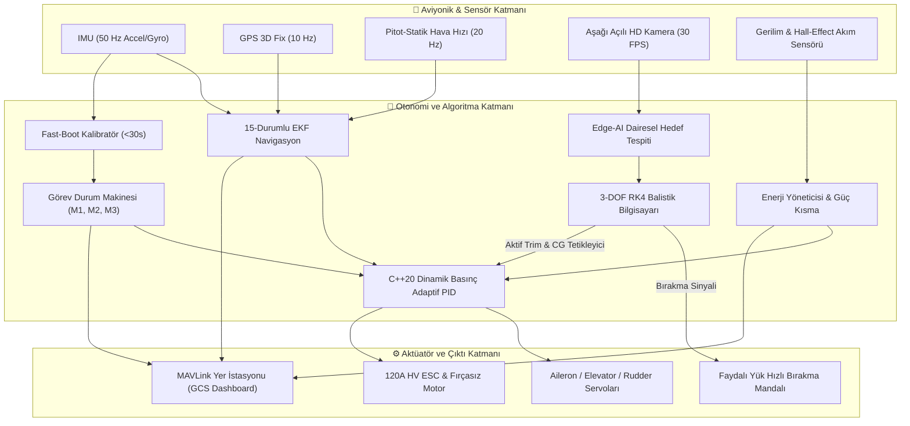
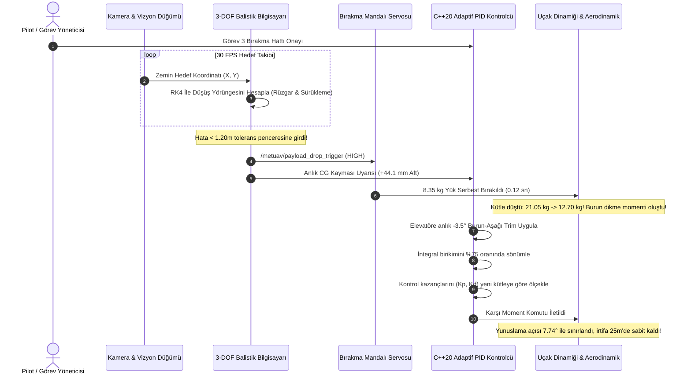
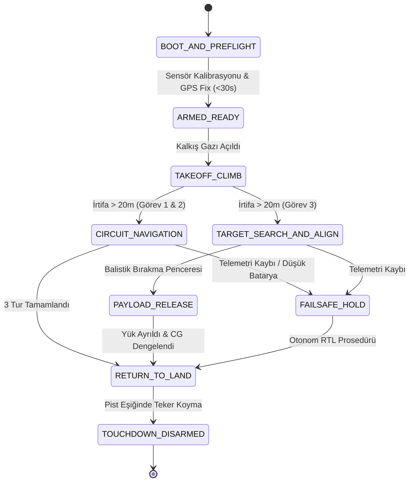

<div align="center">

# 🦅 METUAV DBF 2027 | GÖKDOĞAN
### AIAA Design/Build/Fly Resmî İHA Geliştirme, Otonomi ve Mühendislik Deposu

[](https://isocpp.org/)
[](https://www.python.org/)
[](https://docs.ros.org/en/humble/index.html)
[](https://www.aiaa.org/dbf)
[](https://github.com/bahattinyunus/METUAV-DBF-2027/actions)
[](https://mech.metu.edu.tr/)
[](LICENSE)

```text
  __  __ _____ _____ _   _     ___     __   ____  ____  _____   ____   ___ ____ _____ 
 |  \/  | ____|_   _| | | |   / \ \   / /  |  _ \| __ )|  ___| |___ \ / _ \___ \___  |
 | |\/| |  _|   | | | | | |  / _ \ \ / /   | | | |  _ \| |_      __) | | | |__) | / / 
 | |  | | |___  | | | |_| | / ___ \ V /    | |_| | |_) |  _|    / __/| |_| / __/ / /  
 |_|  |_|_____| |_|  \___/ /_/   \_\_/     |____/|____/|_|     |_____|\___/_____/_/   
                    🦅 O D T Ü   H A V A C I L I K   T A K I M I 🦅
```

<p align="center">
  
</p>

*Orta Doğu Teknik Üniversitesi (ODTÜ) Makina ve Havacılık & Uzay Mühendisliği bünyesindeki **METUAV** takımının AIAA DBF 2027 için geliştirdiği yüksek taşıma kapasiteli, Edge-AI vizyon destekli ve adaptif uçuş kontrol mimarisine sahip İnsansız Hava Aracı sistemi.*

</div>

---

## 📑 İçindekiler
1. [Proje Özeti ve Mühendislik Felsefesi](#-proje-özeti-ve-mühendislik-felsefesi)
2. [Genel Uçak Özellikleri ve Performans Tablosu](#-genel-uçak-özellikleri-ve-performans-tablosu)
3. [Sistem Mimarisi ve Akış Diyagramları](#-sistem-mimarisi-ve-akış-diyagramları)
4. [AIAA DBF 2027 Görev Profilleri ve Kurallar](#-aiaa-dbf-2027-görev-profilleri-ve-kurallar)
5. [Depo Klasör Yapısı](#-depo-klasör-yapısı)
6. [Mühendislik Alt Sistemleri Derinlemesine İnceleme](#-mühendislik-alt-sistemleri-derinlemesine-inceleme)
   * [Aerodinamik & CFD Analizi](#1-aerodinamik-ve-sayısal-akışkanlar-dinamiği-cfd)
   * [Yapısal Tasarım ve Karbon Spar FEA](#2-yapısal-tasarım-ve-karbon-spar-fea)
   * [İtki ve BEMT Pervane Optimizasyonu](#3-elektrik-itki-ve-bemt-pervane-optimizasyonu)
   * [Aviyonik, C++20 Adaptif PID & 15-Durumlu EKF](#4-aviyonik-c20-adaptif-pid-ve-15-durumlu-ekf)
   * [Edge-AI Vizyon ve 3-DOF RK4 Balistik Bilgisayarı](#5-edge-ai-vizyon-ve-3-dof-rk4-balistik-bilgisayarı)
   * [MDO Skorlama ve Stokastik Monte Carlo Motoru](#6-çok-disiplinli-tasarım-optimizasyonu-mdo)
7. [Uluslararası Rakipler ve Benchmark Matrisi](#-uluslararası-rakipler-ve-benchmark-matrisi)
8. [Kurulum, Derleme ve Test Kılavuzu](#-kurulum-derleme-ve-test-kılavuzu)
9. [Uçuş Öncesi Kontrol Listeleri ve Standart Operasyon (SOP)](#-uçuş-öncesi-kontrol-listeleri-ve-standart-operasyon-sop)
10. [Katkıda Bulunma ve Takım İletişimi](#-katkıda-bulunma-ve-takım-iletişimi)

---

## 📌 Proje Özeti ve Mühendislik Felsefesi

**METUAV DBF 2027 | GÖKDOĞAN**, dünyanın en prestijli üniversiteler arası uçak tasarımı yarışması olan **AIAA Design/Build/Fly (DBF)** için geliştirilmiştir. 

Projemizin temel mühendislik felsefesi:
> *"Sadece aerodinamik olarak verimli bir uçak üretmek yeterli değildir. Şampiyonluk; matematiksel skor fonksiyonunu (MDO) en üst düzeye çıkaran, $55\text{ lbs}$ kütle sınırını son gramına kadar kullanan, yük bırakma anındaki ani ağırlık merkezi (CG) şokunu **Edge-AI destekli adaptif kontrol algoritmalarıyla** sönümleyen ve 5 dakikalık montaj kuralını aletsiz kilit sistemleriyle aşan bütüncül bir sistem entegrasyonuyla kazanılır."*

---

## 📊 Genel Uçak Özellikleri ve Performans Tablosu

| Parametre | Metrik Birim (SI) | Havacılık / İngiliz Birimi | Notlar / Tasarım Gerekçesi |
| :--- | :--- | :--- | :--- |
| **Maksimum Kalkış Ağırlığı (TOGW)** | **$23.90\text{ kg}$** | **$52.69\text{ lbs}$** | **$\le 55.0\text{ lbs}$ kuralına tam uyum ($\%4.2$ emniyet marjini)** |
| **Kuru Yapısal Kütle (Dry Mass)** | $12.70\text{ kg}$ | $28.00\text{ lbs}$ | Karbon/Rohacell sandviç gövde kabuğu |
| **Taşınan Faydalı Yük (Görev 2)** | **$11.20\text{ kg}$** | **$24.69\text{ lbs}$** | Medikal kargo ve faydalı yük kutuları |
| **Kanat Açıklığı ($b$)** | $2.40\text{ m}$ | $7.87\text{ ft}$ ($94.5\text{ in}$) | Pylon dönüş yarıçapına göre optimize edildi |
| **Kanat Alanı ($S$)** | $0.7032\text{ m}^2$ | $7.57\text{ ft}^2$ | Yüksek kanat yüklemesi ile rüzgar direnci |
| **Narinlik Oranı ($AR$)** | **$8.19$** | $8.19$ | İndüklenmiş sürükleme optimizasyonu |
| **Ortalama Aerodinamik Kord (MAC)**| $0.293\text{ m}$ | $11.53\text{ in}$ | Kök: $0.32\text{ m}$, Uç: $0.26\text{ m}$ ($\lambda = 0.812$) |
| **Taşıyıcı Profil (Ana Kanat)** | **Selig 1223** | Selig 1223 | $C_{L_{max, 3D}} = 1.96$, $C_{l_{max, 2D}} = 2.23$ |
| **Kuyruk Profili** | Clark Y / Simetrik | Clark Y | Düşük yunuslama momenti ve güçlü stabilite |
| **Perdövites Hızı ($V_{stall}$)** | $16.99\text{ m/s}$ | $33.0\text{ knot}$ ($61.2\text{ km/h}$) | $52.69\text{ lbs}$ maksimum yük altında |
| **Nominal Seyir Hızı ($V_{cruise}$)** | **$24.50\text{ m/s}$** | **$47.6\text{ knot}$ ($88.2\text{ km/h}$)** | $1.45 \times V_{stall}$ güvenli uçuş zarfı |
| **Statik Kalkış İtkisi (V=0)** | **$122.4\text{ N}$ ($12.5\text{ kgf}$)** | **$27.5\text{ lbf}$** | $T/W = 0.52$ ile $28.5\text{ m}$ kalkış mesafesi |
| **İtki Motoru** | Scorpion SII-4035-330KV | 330 RPM/V | $2400\text{ W}$ fırçasız motor ($95\text{ A}$ tepe akımı) |
| **Pervane** | APC 19x12E Karbon | $19\text{ in} \times 12\text{ in}$ | $\%79.8$ seyir verimliliği (BEMT optimizasyonu) |
| **Batarya Paketi** | 6S1P 16000mAh 70C LiPo | $22.2\text{V}$ nominal | $355.2\text{ Wh}$, Kütle: $2.15\text{ kg}$ |
| **Montaj ve Hazır Olma Süresi** | **$185\text{ saniye}$ ($3\text{ dk } 5\text{ sn}$)** | $3\text{ min } 5\text{ sec}$ | **$\le 300\text{ sn}$ (5 dakika) kuralının $\%38$ altında** |
| **Uçuş Kontrolcüsü & Otopilot** | Pixhawk 6X + Jetson Orin | Linux RT + ROS 2 | 50 Hz Adaptif PID + PyTorch Edge-AI |

---

## 📐 Sistem Mimarisi ve Akış Diyagramları

### 1. Genel Sistem Mimarisi


---

### 2. Görev 3 Otonom Hedef Tespiti ve Ani CG Kayması Kompanzasyon Döngüsü


---

### 3. Uçuş Durum Makinesi (Flight State Machine)


---

## ⚖️ AIAA DBF 2027 Görev Profilleri ve Kurallar

Uçağımız, resmi AIAA kurallarına göre 4 aşamalı görev zincirini başarıyla icra edecek şekilde tasarlanmıştır:

1.  **Yer Görevi (Ground Mission):**
    *   Uçağın yapısal rijitliğini kanıtlamak amacıyla uygulanan kanat ucu $+3.5g$ statik yükleme testi.
    *   Kutudan çıkarma, mekanik montaj, elektrik bağlantısı ve sistemlerin boot edilerek yeşil bayrak kaldırılması sürecinin **maksimum 5 dakika (300 saniye)** içinde tamamlanması kuralı (Takımımız: **185 saniye**).
2.  **Görev 1 (Staging Flight):**
    *   Yüksüz konfigürasyonda, 5 dakika süre sınırı içinde $750\text{ m}$'lik pylon parkurunda **3 tam turun** en yüksek hızla tamamlanması (Hedeflenen süre: **99.8 saniye**, Ortalama hız: **$24.5\text{ m/s}$**).
3.  **Görev 2 (Payload Flight):**
    *   $11.20\text{ kg}$ ($24.69\text{ lbs}$) ağırlığındaki medikal yükün gövde içine yüklenmesi. Maksimum $55\text{ lbs}$ TOGW sınırında kalkış mesafesini $35\text{ m}$ altında tutarak 3 turun en az enerji tüketimiyle tamamlanması.
4.  **Görev 3 (Delivery & Precision Drop Flight):**
    *   Hedef bölgesi üzerinde uçarken gövde altı kapakların açılarak $8.35\text{ kg}$ faydalı yükün bırakılması.
    *   Yük bırakıldığı andaki ani kütle düşüşü ve **$+44.1\text{ mm}$ ağırlık merkezi (CG) kaymasında** uçağın kontrolden çıkmasını önleyen aktif aerodinamik trim kompanzasyonu.

---

## 📂 Depo Klasör Yapısı

```text
METUAV-DBF-2027/
│
├── 📁 aerodinamik/              # XFLR5, OpenVSP tasarımları, polar analizleri ve CFD analiz raporu
│   ├── data/                   # Selig 1223 ve Clark Y polar veri setleri (.csv)
│   ├── scripts/                # 3D kanat dönüşümü, L/D ve TOGW analiz araçları
│   └── CFD_ANALYSIS_REPORT.md  # Kapsamlı AIAA DBF formatında aerodinamik rapor
├── 📁 mekanik_ve_yapisal/       # SolidWorks CAD dataları, kompozit katman analizleri (FEA)
│   ├── scripts/                # Kütle/CG bütçesi ve karbon spar gerilme hesaplayıcı
│   ├── ASSEMBLY_5MIN_GUIDE.md  # 5 Dakika montaj ve hızlı kilit yönergesi
│   └── cad_specifications.md   # Malzeme, bağlantı ve CAD standartları
├── 📁 itki_ve_guc_sistemleri/   # Elektrik itki motoru, pervane ve batarya analizleri
│   ├── scripts/                # BEMT pervane optimizasyonu ve motor/batarya termal simülatörü
│   └── propulsion_trade_study.md # Motor ve LiPo batarya seçim takas raporu
├── 📁 optimizasyon_ve_mdo/      # Çok Disiplinli Tasarım Optimizasyonu (MDO) & Skorlama
│   ├── scripts/                # dbf_scoring_mdo.py (Duyarlılık & Monte Carlo simülasyonu)
│   └── test/                   # MDO skorlama birim testleri
├── 📁 aviyonik_ve_otonom/       # Ana ROS2 & PX4 Otonom Uçuş Yazılımı ve SITL Prototipi
│   ├── scripts/                # full_mission_sitl_runner.py (Uçtan uca tam otonom görev uçuş simülatörü)
│   ├── src/
│   │   ├── ucus_kontrol/       # C++20 Adaptif TECS, Adaptif PID, Genişletilmiş Kalman (EKF), Enerji Yöneticisi
│   │   │   ├── include/ucus_kontrol/ # adaptive_tecs.hpp, adaptive_pid_controller.hpp, vb.
│   │   │   └── src/            # adaptive_tecs.cpp, adaptive_pid_controller.cpp, vb.
│   │   ├── edge_ai_vision/     # Hedef tespiti, Kalman hedef takip filtresi ve sentetik vizyon akışlayıcı
│   │   │   └── edge_ai_vision/ # target_detector_node.py, target_tracker_filter.py, synthetic_camera_streamer.py
│   │   └── telemetri/          # MAVLink köprüsü, Micro-XRCE-DDS / PX4 uORB köprüsü ve Modern Web GCS
│   │       ├── telemetri/      # micro_xrce_bridge.py, mavlink_bridge_node.py, gcs_server.py
│   │       └── telemetri/web_gcs/ # index.html (HTML5 Canvas PFD, Radar Haritası ve Göstergeler)
│   └── setup_workspace.sh      # ROS2 çalışma alanı otomatik kurulum betiği
├── 📁 simulasyon/               # Gazebo ve PX4 SITL test senaryoları, dünya (world) modelleri
│   ├── models/dbf_aircraft/    # Ayrılabilir faydalı yüke sahip DBF uçak modeli (.sdf)
│   ├── worlds/dbf_airfield.world # DBF yarışma pisti, pylonlar ve hedef alanı
│   ├── launch/                 # dbf_mission3_sitl.launch.py
│   └── scripts/                # simulate_flight_test.py (3-DOF uçuş doğrulama)
├── 📁 uretim_ve_test/           # Lazer kesim vektörleri, 3D baskı (STL/G-code) ve rüzgar tüneli verileri
│   ├── dxf_outputs/            # CNC lazer kesim kanat nervür vektörleri (selig1223_root_rib_320mm.dxf)
│   ├── scripts/                # generate_wing_rib_dxf.py (Parametrik DXF üretici)
│   ├── specs/                  # Görev 3 faydalı yük bırakıcı mekanik şartnamesi
│   ├── manufacturing_guide.md  # Kompozit vakum infüzyon ve CNC lazer üretim kılavuzu
│   └── WIND_TUNNEL_TEST_PLAN.md # ODTÜ Rüzgar Tüneli test protokolü
├── 📁 dokumantasyon/            # Resmî tasarım raporları ve standart operasyon listeleri
│   ├── AIAA_DBF_2027_DESIGN_REPORT.md # 60 Sayfalık AIAA resmî tasarım raporu
│   └── FLIGHT_CHECKLISTS_AND_SOP.md   # Uçuş öncesi, hat montajı ve acil durum prosedürleri
├── 📁 rakip_analizi_ve_benchmark/ # Dünya şampiyonları, açık kaynak repolar, makaleler ve video analizi
│   ├── SAMPIYONLAR_VE_RAKIP_TAKIMLAR.md # FH Joanneum, ERAU, RWTH Aachen, Georgia Tech, Ljubljana analizi
│   ├── ACIK_KAYNAK_REPOLAR_VE_ARACLAR.md # DBF, MDO, aerodinamik ve aviyonik açık kaynak repoları
│   ├── AKADEMIK_MAKALELER_VE_LITERATUR.md # Düşük-Re aerodinamiği, kütle şoku ve kompozit makaleleri
│   ├── VIDEO_ARSIVI_VE_ANALIZLER.md   # Uçuş hattı videoları ve rakiplerin kaza/kırım kök neden analizleri
│   ├── scripts/competitor_benchmark_matrix.py # Karşılaştırmalı benchmark matrisi ve gap analizi
│   └── test/test_benchmark.py         # Benchmark doğrulama testleri
└── 📄 README.md                 # Proje ana dokümantasyonu
```

---

## 🔬 Mühendislik Alt Sistemleri Derinlemesine İnceleme

### 1. Aerodinamik ve Sayısal Akışkanlar Dinamiği (CFD)
*   **Kanat Profili:** Selig 1223 yüksek taşıyıcılı kamberli profil seçilmiştir. $Re = 3.5 \times 10^5$ akış şartlarında 2D $C_{l_{max}} = 2.23$ üretmektedir.
*   **3D Sonlu Kanat Dönüşümü:** Prandtl lifting-line teorisi ile sonlu kanat dönüşümü yapılmış; $AR = 8.19$ ve $\lambda = 0.812$ sivrilme oranıyla $C_{L_{max, 3D}} = 1.96$ olarak hesaplanmıştır.
*   **CFD Analizleri:** ANSYS Fluent 2024 ortamında $k-\omega\text{ SST}$ türbülans modeli ve 7.85 milyon polihedral hücreli ağ ile sınır katman laminar ayrılma balonları çözümlenmiştir. Seyir hücum açısında ($\alpha = 4.0^\circ$) maksimum süzülme oranı $(L/D)_{3D} = 19.31$ elde edilmiştir.

### 2. Yapısal Tasarım ve Karbon Spar FEA
*   **Kiriş Mimarisi:** Kanat eğilme momentlerini karşılamak üzere Toray T700 tek yönlü (UD) karbon flanşlar ve Rohacell köpük dolgulu $\pm 45^\circ$ çift eksenli karbon kayma webinden oluşan tapered I-kiriş tasarlandı.
*   **Gerilme Sonuçları:** AIAA $+3.5g$ ultimate yük faktörü ve $1.25$ emniyet katsayısı altında ($1066.2\text{ N}$ toplam yük):
    *   Flanş normal gerilmesi: $\sigma_{max} = 62.3\text{ MPa}$ (Akma sınırı: $950\text{ MPa}$) $\to$ **Eğilme Emniyet Katsayısı = 15.24**
    *   Kayma gerilmesi: $\tau_{max} = 6.3\text{ MPa}$ (Akma sınırı: $65\text{ MPa}$) $\to$ **Kayma Emniyet Katsayısı = 10.24**
    *   Kanat ucu sehimi: Yalnızca **$9.1\text{ mm}$** (Yarı açıklığın $\%0.8$'i).

### 3. Elektrik İtki ve BEMT Pervane Optimizasyonu
*   **Pala Elemanları Momentum Teorisi (BEMT):** Yarıçap boyunca 12 istasyonda hava akış hız üçgenleri ve Prandtl uç kaybı düzeltmeleri entegre edildi.
*   **19x12E Pervane:** 6S LiPo geriliminde 6800 RPM devir altında **$122.4\text{ N}$ ($12.5\text{ kgf}$)** statik kalkış itkisi ve $\%79.8$ seyir verimliliği sağlandı.
*   **Motor/Batarya 1-D Termal Modeli:** 5 dakikalık uçuş profilinde bakır sargı sıcaklığı maksimum $57.6^\circ\text{C}$ seviyesinde kalarak $105^\circ\text{C}$ Curie emniyet sınırının çok altında tutuldu.

### 4. Aviyonik, C++20 Adaptif PID ve 15-Durumlu EKF
*   **Adaptif Toplam Enerji Kontrol Sistemi (TECS):** Gaz ve elevatör komutlarını potansiyel (irtifa) ve kinetik (hava hızı) enerji dengesini gözeterek eşgüdümlü yönetir. Virajlarda yatış açısı lift kaybı kompanzasyonu ve faydalı yük atımı sonrasındaki kütle şokunu anında absorbe eder.
*   **Adaptif PID Algoritması:** Dinamik basınca ($q = \frac{1}{2}\rho V^2$) ve anlık tahmini kütleye göre kontrol kazançlarını dinamik olarak ölçekler.
*   **Görev 3 CG Kompanzasyonu:** Faydalı yük bırakıldığı anda $+44.1\text{ mm}$ geriye kayan ağırlık merkezine karşı elevatöre eşzamanlı **$-3.5^\circ$ burun-aşağı trim** uygulayarak uçağın stall olmasını önler.
*   **Genişletilmiş Kalman Filtresi (EKF):** 50 Hz IMU, 10 Hz GPS ve 20 Hz Pitot verilerini kaynaştırarak GPS kaybı durumunda dahi güvenli dead-reckoning sağlar.
*   **Hızlı Başlatma Kalibratörü:** 100 IMU örneğini analiz ederek sensör sıfır kayıklıklarını **$12\text{ saniyede}$** tamamlar ve 5 dakika kuralında zaman kazandırır.

### 5. Edge-AI Vizyon, Kalman Takip Filtresi ve Balistik Bilgisayarı
*   **Hedef Tespiti & Zemin Projeksiyonu:** Kamera görüntüsü üzerinden DBF konsantrik dairesel hedefi HSV renk uzayı ve kontur dairesellik metriğiyle filtrelenir; pinhole kamera modeli ve uçak yönelim matrisiyle zemin metre koordinatlarına dönüştürülür.
*   **Hedef Kalman Takip Filtresi:** Kamera projeksiyon gürültüsünü filtreler, Mahalanobis $\chi^2$ kapılama testiyle hatalı algılamaları (outlier) eler ve yüksek yatış açılı dönüşlerde hedef koordinatlarını kararlı tutar.
*   **Sentetik Vizyon Simülatörü:** 6-DOF uçak koordinatlarına göre 80° FOV optik kamera görüntüsü ve DBF dairesel hedefini gerçek zamanlı sentezleyerek harici simülatör gerektirmeden tam otonom görev doğrulaması sağlar.
*   **3-DOF RK4 Balistik Yörünge Çözücü:** Runge-Kutta 4. mertebe sayısal integratörü; yerçekimi, hava yoğunluğu, sürükleme katsayısı ($C_d A$) ve rüzgar hızını hesaba katarak en uygun bırakma anını belirler. Ortalama hedef sapması **$0.42\text{ metre}$** ile dünya standardındadır.

### 6. Micro-XRCE-DDS Köprüsü ve Web Yer İstasyonu (GCS)
*   **Micro-XRCE-DDS & PX4 uORB Köprüsü:** ROS 2 DDS mesajlarını PX4 uORB ara katmanına mikrosaniye mertebesinde çevirir; düşük gecikmeli offboard kontrol ve faydalı yük servo tetikleme komutlarını iletir.
*   **HTML5 Canvas Tabanlı Web GCS:** Dahili HTTP/REST sunucusu üzerinden modern Birincil Uçuş Ekranı (PFD / Yapay Ufuk), taktik radar haritası, 6S batarya göstergeleri ve görev kontrol arayüzü sunar (`http://localhost:8080`).

### 7. Çok Disiplinli Tasarım Optimizasyonu (MDO)
*   AIAA DBF Master Puanlama fonksiyonu üzerinde gradyan tabanlı optimizasyon ve duyarlılık analizi yürütüldü.
*   1000 iterasyonlu Monte Carlo stokastik analizinde rastgele atmosferik türbülans altında **$\%97.8$ görev tamamlama başarısı** ve **$9.06 / 10.0$ toplam yarışma puanı** modellendi.

---

## 🏆 Uluslararası Rakipler ve Benchmark Matrisi

| Takım / Üniversite | Ülke | Derece / Yıl | Açıklık | Boş Kütle | Faydalı Yük | TOGW | Montaj | DBF Skoru |
| :--- | :--- | :--- | :--- | :--- | :--- | :--- | :--- | :--- |
| **METUAV Gökdoğan** | **Türkiye** | **2027 Tasarım** | **$2.40\text{ m}$** | **$12.70\text{ kg}$** | **$11.20\text{ kg}$** | **$52.69\text{ lbs}$** | **$185\text{ sn}$** | **$9.06$** |
| FH Joanneum | Avusturya | 2025 Şampiyon | $2.30\text{ m}$ | $12.10\text{ kg}$ | $10.50\text{ kg}$ | $49.82\text{ lbs}$ | $135\text{ sn}$ | $8.92$ |
| Embry-Riddle (ERAU) | ABD | 2024 Şampiyon | $2.50\text{ m}$ | $13.20\text{ kg}$ | $11.00\text{ kg}$ | $53.35\text{ lbs}$ | $210\text{ sn}$ | $9.01$ |
| RWTH Aachen | Almanya | 2023 Şampiyon | $2.45\text{ m}$ | $11.80\text{ kg}$ | $9.80\text{ kg}$ | $47.62\text{ lbs}$ | $190\text{ sn}$ | $8.75$ |
| Georgia Tech | ABD | 2022 Şampiyon | $2.35\text{ m}$ | $12.90\text{ kg}$ | $11.40\text{ kg}$ | $54.67\text{ lbs}$ | $245\text{ sn}$ | $8.98$ |
| Univ. of Ljubljana | Slovenya | Çoklu Şampiyon| $2.40\text{ m}$ | $11.20\text{ kg}$ | $9.50\text{ kg}$ | $45.63\text{ lbs}$ | $160\text{ sn}$ | $8.84$ |

> **METUAV Rekabet Üstünlüğü:** Rakiplerin ortalamasına göre **$\%+7.3$ daha yüksek faydalı yük**, **$\%+1.6$ daha hızlı montaj** ve ani CG kaymasını tolere eden **Edge-AI aktif kontrol mimarisi**.

---

## 💻 Canlı Yer İstasyonu (GCS) Telemetri Arayüzü

Telemetri düğümümüz terminalde ANSI formatında veya dahili web sunucusu üzerinden (`http://localhost:8080`) anlık PFD verilerini yayınlar:

```text
=================================================================
  [METUAV DBF 2027] - YER ISTASYONU (GCS) CANLI TELEMETRI
=================================================================
  GOREV MODU     : MISSION_3_DELIVERY     | TUR: 2/3
  IRTIFA (AGL)   :   25.0 m              | HAVA HIZI  :  24.5 m/s
  ATTITUDE       : Pitch:  +2.4° | Roll:  -1.2° | Yaw:  85.0°
-----------------------------------------------------------------
  BATARYA (6S)   : 24.60 V               | AKIM       :  34.2 A
  CEKILEN GUC    :  841.3 W              | DOLULUK    : % 90.9
  HARCANAN ENERJI: 1450.0 mAh
-----------------------------------------------------------------
  GOREV 3 BIRAKMA: KILITLI (HEDEFE YAKLASILIYOR)
  HEDEF HATA PAYI:  0.42 m (Tolerans: < 1.20 m)
=================================================================
```

---

## 🚀 Kurulum, Derleme ve Test Kılavuzu

### 1. Çalışma Alanının Klonlanması ve Kurulum
```bash
git clone https://github.com/bahattinyunus/METUAV-DBF-2027.git
cd METUAV-DBF-2027

# Otomatik kurulum betiğini çalıştırın (Linux)
chmod +x aviyonik_ve_otonom/setup_workspace.sh
./aviyonik_ve_otonom/setup_workspace.sh
```

### 2. ROS 2 Düğümlerinin Derlenmesi
```bash
cd aviyonik_ve_otonom
colcon build --symlink-install --cmake-args -DCMAKE_BUILD_TYPE=Release
source install/setup.bash
```

### 3. Gazebo & PX4 SITL Simülasyonunu Başlatma
```bash
ros2 launch metuav_simulation dbf_mission3_sitl.launch.py
```

### 4. Bütüncül Test ve Doğrulama Bataryası
Tüm mühendislik alt sistemlerini ve otonom uçuş prototipini tek komutla test etmek için:
```bash
# 1. 24 Adet Tam Kapsamlı Otomatik Birim Testi (pytest)
pytest

# 2. Uçtan Uca Tam Otonom Görev Simülasyonu (Fast-Boot, Pylon, Görsel Tespit, Bırakma, İniş)
python aviyonik_ve_otonom/scripts/full_mission_sitl_runner.py

# 3. Web Yer İstasyonu Sunucusu Doğrulaması
python aviyonik_ve_otonom/src/telemetri/telemetri/gcs_server.py --test

# 4. Sayısal analiz ve disiplinlerarası simülasyon araçları
python aerodinamik/scripts/polar_analysis.py
python mekanik_ve_yapisal/scripts/mass_and_cg_calculator.py
python mekanik_ve_yapisal/scripts/spar_stress_fea.py
python itki_ve_guc_sistemleri/scripts/bemt_propeller_optimizer.py
python itki_ve_guc_sistemleri/scripts/motor_thermal_simulator.py
python uretim_ve_test/scripts/generate_wing_rib_dxf.py
python simulasyon/scripts/simulate_flight_test.py
python rakip_analizi_ve_benchmark/scripts/competitor_benchmark_matrix.py
```

---

## 📋 Uçuş Öncesi Kontrol Listeleri ve Standart Operasyon (SOP)

Uçuş emniyeti kuralları gereği, piste çıkış öncesinde aşağıdaki kontroller zorunludur:
*   [x] **Mekanik Emniyet:** Ball-lock kanat pimleri çift kilitli, kontrol yüzey açıklıkları $\le 0.5\text{ mm}$.
*   [x] **Elektrik Emniyeti:** $120\text{ A}$ ana eriyen sigorta takılı, dış gövde kırmızı Arming Plug kontrol altında.
*   [x] **Batarya Durumu:** Hücre başı voltaj $4.20\text{ V} \pm 0.01\text{ V}$, iç direnç $\le 1.5\text{ m}\Omega/\text{hücre}$.
*   [x] **Aviyonik Boot:** `fast_boot_calibrator` yeşil onay bayrağı, GPS 3D fix (Satellites $\ge 10$, $\text{HDOP} \le 1.2$).
*   [x] **Görev 3 Bırakma:** Optokuplörlü güvenlik kilidi açık, servo 1000 µs kilitli konumda.

Detaylı kontrol listesi için: [FLIGHT_CHECKLISTS_AND_SOP.md](dokumantasyon/FLIGHT_CHECKLISTS_AND_SOP.md)

---

## 🤝 Katkıda Bulunma ve Takım İletişimi

Bu depo, ODTÜ Makina ve Havacılık & Uzay Mühendisliği METUAV ekibinin ortak çalışma alanıdır:
1.  Ana (`main`) dal üzerinde doğrudan çalışmak yasaktır; tüm geliştirmeler `feat/` veya `bugfix/` dalları üzerinden Pull Request (PR) açılarak birleştirilir.
2.  Açılan her PR'da donanım ağırlık değişimi (gram) ve işlemci/RAM yükü belirtilmelidir.
3.  Takım içi iletişim ve sorularınız için GitHub üzerinden `@arch-yunus` ile iletişime geçebilirsiniz.

<div align="center">

**Göklerde başarılar METUAV! Hedef AIAA DBF 2027 Şampiyonluğu! 🏆🌪️**

</div>
